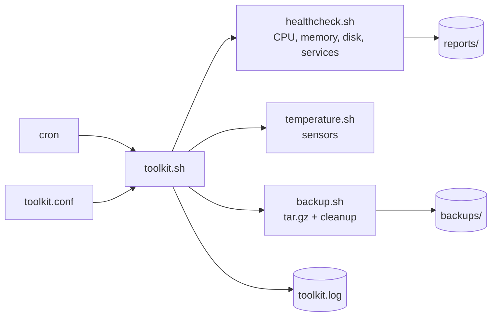

# Server Health & Backup Toolkit

A small set of Bash scripts that **checks the health of a Linux server, backs up an important folder, and runs by itself with cron**. Built in Week 1 of my DevOps journey.

  

## Problem
Servers fail quietly: disks fill up, memory runs out, services stop, and nobody has a recent backup. Checking this by hand every day is slow and easy to forget.

## Solution
One command runs all checks, saves reports and logs, creates a verified backup, and removes old backups. Cron runs it automatically.

## Architecture


## Features
| Feature | Details |
|---|---|
| Health check | Load vs CPU cores, memory %, disk % per mount, top 5 processes, service status |
| Temperature check | Reads `/sys/class/thermal` and `sensors`; skips cleanly on VMs and cloud servers |
| Backup | Dated `.tar.gz`, verified with `tar -tzf`, old backups deleted after N days |
| Config file | Change folders, limits and services in `toolkit.conf` without editing code |
| Logging | Every run is written to `toolkit.log` with time and result |
| Exit codes | `0` = all good, `1` = problem found (works with cron, CI and monitoring) |
| Cron installer | `install.sh` adds or removes the cron jobs safely |

## Project Structure
```
mega-project/
  README.md
  docs/                  screenshots go here
  src/
    toolkit.sh           main runner
    toolkit.conf         settings
    healthcheck.sh       system health report
    temperature.sh       temperature check
    backup.sh            backup + cleanup
    install.sh           cron installer
```

## How to Run
```bash
git clone https://github.com/shubhamnishane-064/DevOps-Trip.git
cd DevOps-Trip/week-01-linux-bash/7-sun/mega-project/src

chmod +x *.sh
nano toolkit.conf            # set SOURCE_DIR, BACKUP_DIR, limits

./toolkit.sh                 # run everything
./toolkit.sh health          # only health check
./toolkit.sh backup          # only backup
```

### Run automatically
```bash
./install.sh --print         # preview the cron lines
./install.sh --install       # add them
crontab -l                   # check
./install.sh --remove        # remove them again
```
Default schedule: health check every 30 minutes, backup every day at 2 AM.

## Sample Output
```
2026-10-13 04:59:10 =========== TOOLKIT START (all) on myserver ===========
2026-10-13 04:59:10 --- HEALTH CHECK ---
2026-10-13 04:59:10 OK    health check: system healthy
2026-10-13 04:59:10 --- TEMPERATURE ---
2026-10-13 04:59:10 SKIP  no temperature sensor (normal on VM / cloud)
2026-10-13 04:59:10 --- BACKUP ---
2026-10-13 04:59:10 OK    backup created in /home/shubham/toolkit/backups
2026-10-13 04:59:10 RESULT: ALL GOOD
```
Add real screenshots to `docs/` (health report, backup folder, `crontab -l`).

## Skills Shown
Linux file system and permissions, process and service management, Bash scripting (functions, arguments, exit codes, `set -euo pipefail`), `tar`/`find` retention, cron scheduling, logging, and documentation.

## Challenges and Fixes
| Problem | Fix |
|---|---|
| Script gave `Permission denied` | Missing execute bit: `chmod +x` (Day 1) |
| Cron job ran nothing | Full paths and `2>&1` logging (Day 3) |
| `%` broke the cron date command | Moved the logic into a script (Day 5) |
| Config line `SOURCE_DIR = /path` failed | No spaces around `=` in shell files (see Day 7 error log) |

Full error write-ups are in each day's `troubleshooting/` folder and in `troubleshooting-index.md`.

## Future Improvements
- Send an email or Slack message when the result is not "ALL GOOD"
- On the (Week 6) we use this backup file on aws 
- Run the same checks from a Jenkins or GitHub Actions job (Weeks 3 and 5)
- Export metrics for Prometheus and Grafana (Week 9)
- Rewrite the runner in Python (planned Python week)