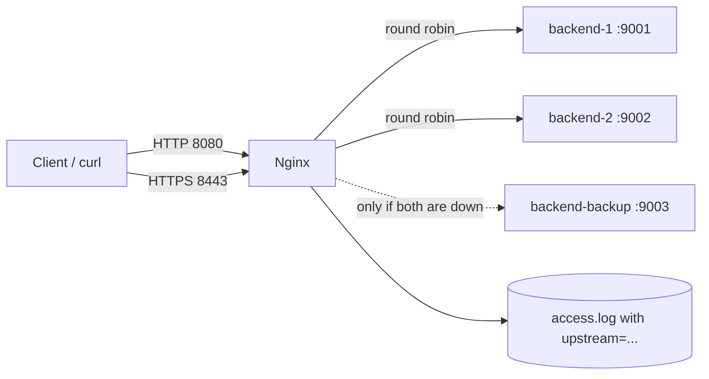

# Nginx Reverse Proxy & Load Balancer Lab

A self-contained lab that runs **Nginx as a reverse proxy and load balancer** in front of three small Python backends, with HTTPS, forwarded client-IP headers, failover to a backup server, and an automatic test script. One command starts it, and one command proves it works.

  

## Problem
One application server is a single point of failure: if it stops, users see errors, and one server can only handle so much traffic. Teams need a front door that shares traffic and survives a failure, and they need to **prove** it behaves correctly when something breaks.

## Solution
Nginx listens on ports 8080 (HTTP) and 8443 (HTTPS) and shares requests between `backend-1` and `backend-2`. A third server (`backend-backup`) is used only when both are down. The lab script starts everything, runs checks, simulates failures step by step, and cleans up.

## Architecture


## Features
| Feature | Details |
|---|---|
| Reverse proxy | `proxy_pass` to an `upstream` group, with `Host`, `X-Real-IP`, `X-Forwarded-For`, `X-Forwarded-Proto` headers |
| Load balancing | Round robin over two backends |
| Failover | `max_fails=2 fail_timeout=5s` plus `proxy_next_upstream`: a dead backend is skipped and the request is retried, so users see no error |
| Backup server | A third backend answers only if both normal backends are down |
| HTTPS | TLS termination with a self-signed certificate generated by the script (TLS 1.2 and 1.3) |
| Observability | Custom access log shows which backend answered (`upstream=127.0.0.1:9002`) and the request time |
| Automation | `lab.sh` starts, tests, breaks, repairs and stops everything, and exits 0 only if all checks pass |
| Safe to run | No root needed, ports above 1024, all files in a local `.lab/` folder (git-ignored) |

## Project Structure
```
mega-project/
  README.md
  .gitignore
  docs/                      screenshots go here
  src/
    lab.sh                   one command to run the whole lab
    nginx.conf.tpl           Nginx config template (lab.sh fills in the paths and ports)
    backend.py               tiny Python backend ("Hello from backend-1")
```

## How to Run
```bash
sudo apt install nginx python3 curl openssl -y     # once
sudo systemctl disable --now nginx                 # optional: stop the default service so ports stay free

cd week-02-networking/7-sun/mega-project/src
chmod +x lab.sh backend.py

./lab.sh demo          # everything: up, test, failover, down. Exit code 0 = all checks passed
```
Or step by step:
```bash
./lab.sh up                      # start 3 backends + Nginx
curl http://localhost:8080/      # run it several times: backend-1, backend-2, backend-1 ...
curl -k https://localhost:8443/  # HTTPS (-k accepts the self-signed certificate)
./lab.sh test                    # balancing, HTTPS, headers and log checks
./lab.sh failover                # stop backends one by one
./lab.sh status                  # what is up or down
./lab.sh logs                    # access and error log
./lab.sh stop-backend 1          # break something yourself
./lab.sh start-backend 1
./lab.sh down                    # stop everything
```

## What the Checks Prove
| Check | Result I expect |
|---|---|
| Health URL | `/nginx-health` answers `ok` |
| Round robin | 20 requests give 10 / 10, backup unused, no errors |
| HTTPS | 4 of 4 requests OK, and `curl` without `-k` rejects the self-signed certificate |
| Forwarded headers | The backend sees `X-Forwarded-For: 127.0.0.1` |
| Logging | Each access-log line contains `upstream=...` |
| Failover 1 | Stop backend-1: all 10 requests still succeed (served by backend-2) |
| Failover 2 | Stop backend-2 too: the **backup** serves all 10 requests |
| Failover 3 | Stop the backup: Nginx returns **502**, and `error.log` shows `no live upstreams` |
| Recovery | Restart all, wait 5 s: traffic is shared again |

## Sample Output
```
TEST 2: round robin, 20 requests over HTTP
      backend-1       10
      backend-2       10
  [PASS] traffic shared between backend-1 and backend-2, backup unused, no errors
FAILOVER 2: stop backend-2 too -> the backup should answer
      backend-backup  10
  [PASS] all 10 requests served by backend-backup
...
RESULT: ALL CHECKS PASSED
```
Add real screenshots to `docs/` (the demo output, `curl` answers alternating, `access.log` with `upstream=`).

## Skills Shown
Nginx configuration (`upstream`, `proxy_pass`, TLS, logging), load balancing and failure handling, HTTP and HTTPS, ports and processes (`ss`, PID files), Bash automation with functions and exit codes, Python, testing failure scenarios, reading error logs, and documentation.

## Challenges and Fixes
| Problem | Fix |
|---|---|
| Test failed on the first run: one request returned an error and the **backup was skipped** later | A start-up race. Nginx started before every backend was ready, so it marked servers as failed (a `backup` entry defaults to `max_fails=1`, `fail_timeout=10s`). Fixed by waiting until every backend answers `/health` before starting Nginx |
| `bind() to 0.0.0.0:8080 failed (98: Address already in use)` | Another program held the port. Found it with `ss -tulpn`, stopped it (see the Day 7 error log) |
| A recovered backend was not used immediately | By design: a failed server stays out for `fail_timeout`. The script waits 6 s |
| Plain `curl` rejected the HTTPS endpoint | Self-signed certificate. Use `curl -k` in the lab, a real certificate (Let's Encrypt, ACM) in production |

Full write-ups are in `troubleshooting/` and in `troubleshooting-index.md`.

## Future Improvements
- Run the same setup with Docker Compose (Nginx plus the backends as containers)
- Add active health checks (Nginx Plus) or move to an AWS Application Load Balancer
- Deploy it on EC2 with Terraform (Weeks 6 and 7)
- Export Nginx metrics to Prometheus and Grafana (Week 9)
- Add `least_conn` and `ip_hash` runs and compare the results