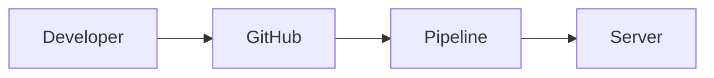

# Sunday Mega Project - Reusable Terraform module set that provisions the Week 6 architecture

Week 7: Terraform IaC

## Problem Statement
What real-world problem does this solve?

## Architecture
(diagram in `docs/architecture.png` or Mermaid below)


## Tech Stack
-

## How to Run
```bash
git clone <repo>
cd <this-folder>
# steps
```

## Features / What it automates
-

## Challenges and Fixes
Link the troubleshooting logs from this week.

## Results
Screenshots, metrics, demo link.

## Future Improvements
-
